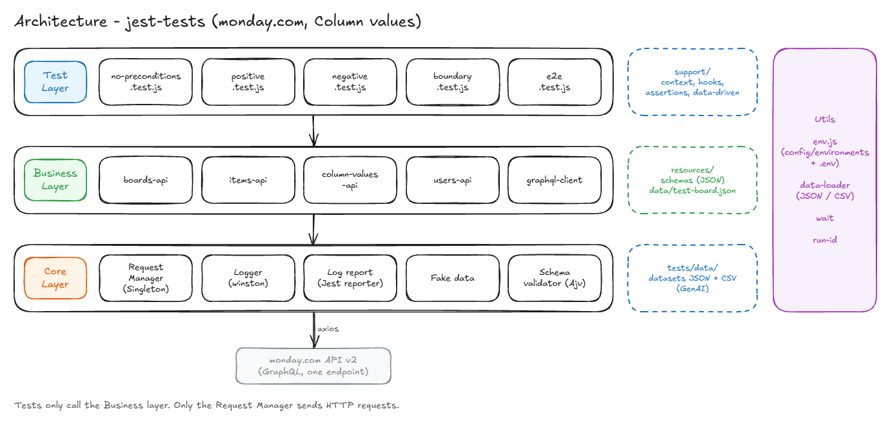
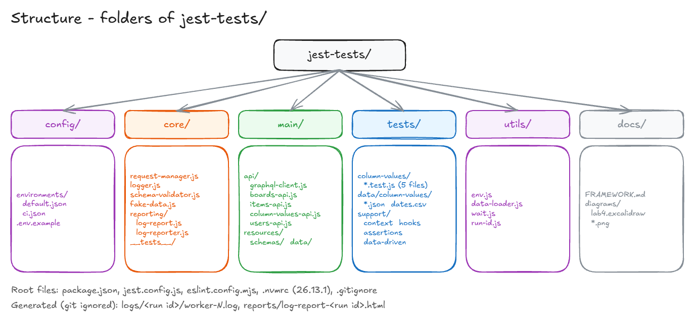
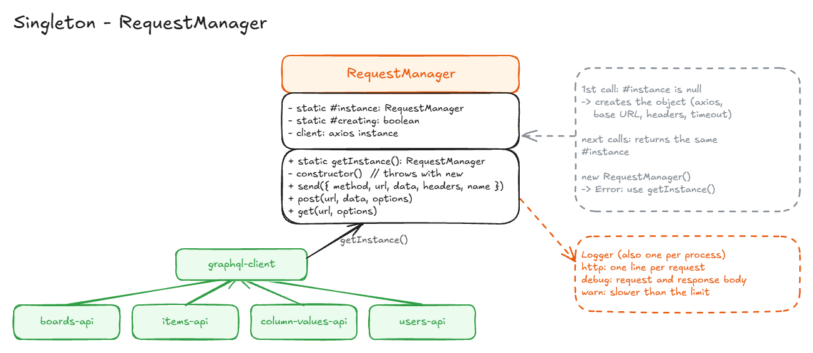

# jest-tests: API test framework for monday.com

Group 3 framework for the monday.com API (feature: Column values, `change_multiple_column_values`).
Stack: Node 26.13.1, Jest 30, axios, Ajv, winston and ESLint.

## 1. How to run it

```bash
cd jest-tests
npm install
cp .env.example .env        # put your MONDAY_TOKEN in .env
npm run lint                # code conventions
npm run test:no-pre         # tests that do not need a board
npm test                    # everything (about 8 minutes because of the rate limit)
```

| Script | What it does |
|---|---|
| `npm test` | All the tests: core unit tests, smoke and column values |
| `npm run test:no-pre` | AUTH-001, TC-COLVAL-008 and 016 (no board needed) |
| `npm run test:column-values` | The 5 suites of column values |
| `npx jest core` | Unit tests of the core layer. They do not need a token |
| `npm run lint` / `npm run lint:fix` | ESLint. `lint:fix` only fixes format, never logic |
| `npm run report:logs [runId]` | Builds the log report again from `logs/` |

Choose another environment with `TEST_ENV`, for example `TEST_ENV=ci npm test`.
The environment is a JSON file in `config/environments/`, so a new environment is a new file, not a new `if` or `switch` in the code.

## 2. Architecture



| Layer | Folder | It knows about | Rule |
|---|---|---|---|
| Test | `tests/` | Business layer, its own datasets and support | Only steps and checks. No URLs, no axios, no GraphQL text |
| Business | `main/` | monday.com: queries, columns, items, boards | One module per resource. Returns the response, never asserts |
| Core | `core/` | HTTP, logs, reports, schemas, fake data | Does not know monday.com. It could be used for another API |
| Utils | `utils/` | Environment, files, time | Small helpers used by all the layers |

A test never calls axios. The flow of one request is:
`positive.test.js -> columnValuesApi.change() -> graphql() -> RequestManager.getInstance().post() -> monday.com`

## 3. Structure



```
jest-tests/
  config/environments/   default.json, ci.json (no secrets)
  core/                  request-manager, logger, schema-validator, fake-data, reporting/, __tests__/
  main/api/              graphql-client, boards-api, items-api, column-values-api, users-api
  main/resources/        schemas/ (JSON schema), data/test-board.json (data used by any test)
  tests/column-values/   no-preconditions, positive, negative, boundary, e2e
  tests/data/            datasets of the tests (JSON and CSV)
  tests/support/         context, hooks, assertions, data-driven
  utils/                 env, data-loader, wait, run-id
  docs/                  this file and the diagrams
```

Data in `main/resources/data` can be used by any test or script (the columns of the test board).
Data in `tests/data` is only for the steps of a test (the rows of a data driven test).

## 4. Request manager (Singleton)



`core/request-manager.js` has the only axios instance of the framework.

- `RequestManager.getInstance()` creates the object the first time and returns the same object after that.
- `new RequestManager()` throws an error, so nobody creates a second client by mistake.
- `send()` measures the time of the request, writes the logs and never throws on 4xx or 5xx (`validateStatus`). The test decides what is right.
- Jest runs each test file in its own module registry, so there is one instance per test file. That is enough because the files run one after the other (`maxWorkers: 1`).

## 5. Logger conventions

The logger is winston (`core/logger.js`). `console.log` is not allowed (ESLint `no-console`).

| Level | Who writes it | Example |
|---|---|---|
| `error` | Core | Request without response (timeout, DNS), status 5xx |
| `warn` | Core | Response slower than `maxResponseTimeMs` |
| `info` | Business and hooks | `Item 123 created on board 456`, `[precondition] ...`, `[postcondition] ...` |
| `http` | Core | `POST change_multiple_column_values -> 200 (412 ms)` (one line per request) |
| `debug` | Core | Request body and response body (cut at 2000 characters) |

Rules:
- Messages in English, short, with the id of what was created or changed.
- Never log the token or the Authorization header.
- Pre and post conditions start with `[precondition]` and `[postcondition]`.
- The tests do not log. The business layer already logs each action.

Format of the console:
`2026-11-22 21:05:33.120 | INFO  | <host> | pid 1234 | w1 | tests/column-values/positive.test.js | Item 123 created ...`
(date, time with ms, level, machine, process, Jest worker, test file, message)

Files: `logs/<run id>/worker-<n>.log`, one JSON line per log with the same fields plus the test name.
Each Jest worker writes its own file, so parallel runs do not mix their lines.
The levels come from the environment (`logLevel` for the file, `consoleLogLevel` for the console) or from `LOG_LEVEL`.

## 6. Log report

`core/reporting/log-reporter.js` is a Jest reporter. When the run ends it reads the logs of the run and writes
`reports/log-report-<run id>.html` with:
- tests, passed and failed, and the number of logs of each level
- number of requests, average, p95 and max response time
- errors and warnings
- every test with its status, its failure and its own logs
- the logs of beforeAll and afterAll

## 7. Pre and post conditions, context

| Hook | Function | What it does |
|---|---|---|
| `beforeAll` | `useTestBoard(ctx)` | Creates the board and the status, date and text columns |
| `afterAll` | `useTestBoard(ctx)` | Deletes the board (and everything inside it) |
| `beforeEach` | `useDelay()` | Waits `delayBetweenTestsMs` (rate limit of monday.com) |
| `beforeEach` | `useTestItem(ctx)` | Creates a new item with the initial values |
| `afterEach` | `useTestItem(ctx)` | Deletes the item, even when the test failed |

The context (`tests/support/context.js`) has one key per feature: `ctx.boards`, `ctx.items`, `ctx.columnValues`.
A test reads `ctx.items.id` or `ctx.boards.id`, never a loose `id`. Every test file creates its own context
and `ctx.items` is replaced before each test, so a test does not see the item of the test before.

## 8. Data driven tests and datasets

`tests/support/data-driven.js` runs the same steps for each row of a dataset (`test.each`).
Rows with `knownBug` run with `test.failing`: they pass while the defect exists and they fail when monday.com fixes it.

| Dataset | Used by | Rows |
|---|---|---|
| `negative-cases.json` | negative.test.js | TC-COLVAL-009 to 016 (from Lab 3) |
| `invalid-values.json` | negative.test.js | Extra negative cases (GenAI) |
| `text-values.json` | boundary.test.js | Text values (GenAI) |
| `dates.csv` | boundary.test.js | Dates and times (GenAI) |

To add a case, add a row. The test code does not change.

## 9. Code conventions (ESLint)

`eslint.config.mjs`: 2 spaces, single quotes, semicolons, trailing commas in multiline, `const` when possible,
`===`, camelCase, no unused variables, no `console`, and the recommended Jest rules in the test files.
Files use kebab-case (`column-values-api.js`), tests end in `.test.js` and the test name starts with the TC id.

## 10. How to add a new feature

1. Add the queries in a new module of `main/api/` (for example `groups-api.js`).
2. Add its schemas in `main/resources/schemas/`.
3. Add a key to the context (`groups: {}`) and the hooks it needs in `tests/support/`.
4. Write the tests in `tests/<feature>/` and the datasets in `tests/data/<feature>/`.
5. `npm run lint` and `npm test` before the pull request.
